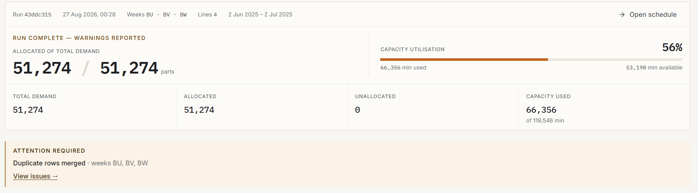
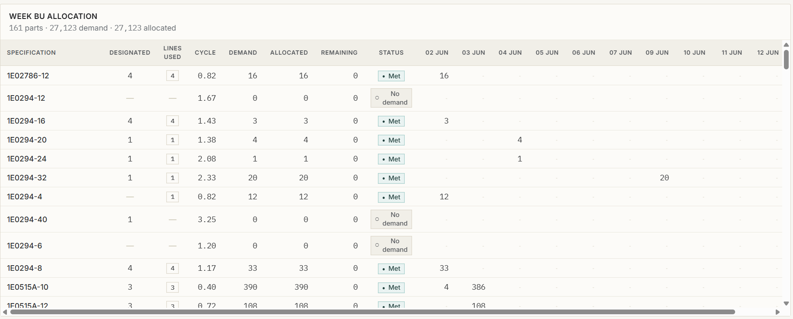

## Problem

Production demand arrived as Excel workbooks containing parts, weekly quantities, production-line assignments, cycle times, and working-day information. Turning that demand into a production plan required handling capacity, allocation priorities, fallback rules, and exceptions without silently overcommitting a line.

The real problem was not simply generating a schedule. It was making the scheduling process `repeatable`, `capacity-aware`, and `trustworthy` while preserving the Excel workflow planners already used.

Vector was built to take the workbook from `upload → validation → normalization → allocation → persistence → review`, with failures and unallocated demand surfaced explicitly instead of disappearing inside a spreadsheet.

---

## Gallery





---

## Background

Vector is an end-to-end production scheduling application built around a manufacturing planning workflow.

The source of truth remains the planner's `.xlsx` workbook. The workbook contains schedule data and a working-days sheet, while the application adds validation, deterministic allocation, capacity visibility, run persistence, and a web dashboard.

The system has three important boundaries:

- `React + Vite` provides the planner-facing dashboard, upload flow, weekly schedule, issues, and history views.
- `Node.js + Express` handles uploads, validation, APIs, persistence, and orchestration.
- A standalone `allocation engine` converts normalized demand into a schedule without depending on HTTP, React, or MongoDB.

MongoDB stores completed planning runs so a generated schedule can be reviewed after the upload request has finished.

---

## Constraints

The system had to work within the existing planning workflow rather than requiring planners to abandon Excel.

Key constraints included:

- Input arrives as `.xlsx` workbooks whose sheet ordering and dimensions cannot be assumed.
- Scheduling rules are operational heuristics rather than a general-purpose optimization model.
- Four production lines have daily capacity constraints.
- Allocation follows a fixed priority order and predefined fallback chains.
- A line-day must never be allocated beyond its remaining capacity.
- Invalid rows and duplicate demand must be handled without corrupting the planning run.
- Demand that cannot be placed must become explicit `unallocated demand`.
- The backend and frontend need to remain separately testable.
- Production deployment needs to serve the React application and API from one origin.
- Upload validation is required because the `xlsx` dependency has known vulnerabilities with no upstream fix currently available.

The biggest design constraint was therefore correctness at the boundaries: bad spreadsheet data should be rejected or diagnosed before it reaches the core scheduler.

---

## Research

Before changing the scheduling workflow, the existing workbook behavior and processing path were examined to understand where assumptions lived.

One important discovery was that workbook structure could not safely be inferred from fixed sheet positions. The parser therefore identifies relevant sheets from meaningful headers and labels.

The allocation behavior was treated as a set of confirmed business rules rather than something to "optimize" without domain evidence. This led to a deterministic heuristic instead of introducing a general-purpose optimization solver.

Testing also shaped the implementation. `Characterization tests` preserve important existing behavior, while `golden-master` snapshots make changes to generated schedules visible.

A separate performance investigation focused on workbook serialization. Some workbooks declared ranges extending toward Excel's approximately 1,048,576-row limit even when most rows were empty. Measuring the actual populated cell extent revealed that the writer was doing far more work than the data required.

---

## Architecture

```text
┌──────────────────┐
│   Excel Upload   │
└────────┬─────────┘
         │
         ▼
┌──────────────────┐
│ Validate / Parse │
└────────┬─────────┘
         │
         ▼
┌──────────────────┐
│    Normalize     │
│ duplicates / bad │
│       rows       │
└────────┬─────────┘
         │
         ▼
┌──────────────────┐
│ Allocation Engine │
│ capacity / rules │
└───────┬─────┬────┘
        │     │
        ▼     ▼
┌───────────┐ ┌──────────────┐
│ MongoDB   │ │ Excel Output │
│ Run Store │ │  / Download  │
└─────┬─────┘ └──────────────┘
      │
      ▼
┌──────────────────┐
│ React Dashboard  │
│ Schedule / Issues│
│      / History   │
└──────────────────┘
```

### Client

`React + Vite + Tailwind CSS` powers the single-page planner interface.

The client displays operational results but does not contain the scheduling rules. It consumes API data for dashboard metrics, weekly schedules, issues, and planning history.

### Server

`Node.js + Express` provides the API, upload handling, validation boundary, and application orchestration.

The backend follows a `routes → controllers → services → models` structure so HTTP concerns remain separate from business logic.

### Allocation Engine

The allocation engine is intentionally independent from the API and UI. It receives normalized planning data and returns allocation results plus diagnostics.

This boundary makes the core scheduling behavior testable without starting the web server.

### Database

`MongoDB + Mongoose` stores planning runs and their allocation results, line totals, and diagnostics.

### Excel Processing

`xlsx` parses the incoming workbook and writes the generated schedule back into the workbook format planners already use.

The parser discovers relevant sheets, validates rows, normalizes demand, and only then passes data to the scheduler.

### Deployment

The production application runs as a `single Node.js service` on Render. Express serves both the built React application and the JSON API from the same origin, with MongoDB providing persistent storage.

---

## Technical Decisions

### Decision: Deterministic heuristic instead of a general optimizer

`Options considered:`

- General-purpose optimization — potentially stronger global optimization, but introduces additional model complexity and makes the confirmed factory rules harder to reason about.
- Deterministic rule-based allocation — directly expresses the known priorities, fallbacks, capacity boundaries, and tolerance behavior.

`Chosen:` Deterministic rule-based allocation.

`Why:` The goal was to reliably implement the confirmed production rules, not to claim that the schedule is globally optimal. A deterministic engine is easier to test, reproduce, and explain to planners.

### Decision: Normalize before allocation

`Options considered:`

- Let the allocation engine interpret raw spreadsheet rows — simpler input plumbing, but business logic becomes coupled to messy workbook data.
- Normalize and validate at the boundary — adds an explicit processing stage but gives the scheduler a predictable internal model.

`Chosen:` Boundary validation and normalization.

`Why:` Duplicate rows, invalid quantities, missing specifications, and invalid cycle times are data-quality concerns. Handling them before allocation keeps the scheduling engine focused on scheduling.

### Decision: Preserve Excel as the primary workflow

`Options considered:`

- Replace Excel with a completely native planning interface.
- Keep Excel as input/output and add validation, scheduling, and visibility around it.

`Chosen:` Preserve the workbook workflow.

`Why:` The application improves the existing process without forcing planners to re-enter demand into a new system.

### Decision: Single-service production deployment

`Options considered:`

- Deploy the frontend and backend separately.
- Serve the built SPA and API from the same Express service.

`Chosen:` Single service.

`Why:` The application does not currently need independent frontend/backend scaling. Same-origin deployment also avoids unnecessary cross-origin configuration.

---

## Challenges

### Excel data was less predictable than the UI suggested

The workbook could contain variable sheet ordering, duplicate part/week rows, invalid quantities, missing specifications, and other data-quality issues.

The solution was to create an explicit `validation → normalization` boundary. Duplicate rows are merged and reported, while invalid records become diagnostics instead of crashing the run or silently entering the scheduler.

### Capacity needed to be enforced continuously

A production line has daily capacity calculated from `workers × 475 minutes`. Allocation therefore cannot simply distribute weekly quantities and check capacity afterward.

The engine maintains a shared running capacity model and ensures every line-day allocation is bounded by `remaining capacity`. Overflow can move only through predefined fallback chains or forward into later eligible dates.

### Workbook serialization became the unexpected bottleneck

The allocation logic was not the slow part of one important workflow. Workbook serialization was.

Some workbooks advertised extremely large used ranges despite containing mostly empty rows. The writer consequently serialized close to a million rows.

The fix recomputed the actual populated extent from cell keys before writing.

Result:

`~75.6s → ~0.54s`

That is approximately `141× faster` for the workbook-write operation, with output verified `byte-identical` across `315,070 cells`.

### Production exposed a dependency-installation difference

The first Render deployment built successfully locally but failed in production because Render's production-mode installation skipped `devDependencies`. `@vitejs/plugin-react` was therefore unavailable when Vite loaded the configuration.

The failure was first `reproduced locally` using the same production-mode install. The dependency was then moved into `dependencies`, followed by a clean production-mode build and full deployment-path verification.

---

## Tradeoffs

- `Deterministic heuristic` over global optimization: easier to verify and explain, but not a universal scheduling optimizer.
- `Single-service deployment` over independent services: simpler operations and same-origin requests, but less flexibility for independent scaling.
- `Excel workflow` over a native planning interface: lower adoption friction, but continued dependence on workbook conventions.
- `Explicit diagnostics` over silent correction: exceptions become visible, but planners must review cases that cannot be allocated.
- `MongoDB persistence` over returning only a generated workbook: enables run history and review, but introduces database availability as a production dependency.

---

## Results

Vector now provides a complete `Excel → schedule` workflow:

- Validates and normalizes planner workbooks.
- Runs deterministic `capacity-aware allocation` across four production lines.
- Applies fixed priorities and fallback chains.
- Prevents line-day overcommitment.
- Surfaces `duplicates`, `invalid input`, and `unallocated demand`.
- Persists planning runs for later review.
- Provides dashboard, weekly schedule, issues, and history views.
- Returns the generated workbook in the planner's existing format.
- Runs as a live production deployment serving the React application and Express API from one origin.

The clearest measured performance result is the workbook serialization optimization:

`~75.6s → ~0.54s`

`~141× faster`, with `byte-identical` output verified across `315,070 cells`.

---

## Lessons Learned

The biggest lesson was that the most important engineering work was often at the boundaries rather than in the main algorithm.

`Validate before allocating.` A scheduler can be logically correct and still produce unreliable results if malformed spreadsheet data reaches it.

`Measure the real bottleneck.` The largest performance improvement came from inspecting what the workbook writer was actually serializing rather than assuming the allocation algorithm was responsible for the delay.

`Reproduce production failures locally.` The Render dependency failure became straightforward once the production installation behavior was reproduced locally.

`Keep business rules isolated.` Separating the allocation engine from HTTP and presentation made the core behavior easier to test and reason about.

`Make exceptions visible.` In production planning, an explicit unallocated quantity is safer than a system that quietly hides the fact that demand could not be scheduled.

---

## Future Improvements

The next improvements should focus on known limitations rather than adding unrelated features.

- Clarify the business meaning behind the remaining `OVERLOAD` diagnostic instead of inferring a rule that has not been confirmed.
- Revisit weekly-bucket tolerance behavior where a small amount of demand can remain unallocated even when later capacity exists.
- Add a continuous integration pipeline so lint, build, and tests run automatically for changes.
- Add representative concurrent-usage and load-testing data before making claims about production scale.
- Continue evaluating the `xlsx` dependency and its vulnerability status as upstream fixes become available.
- Add more operational observability around allocation decisions and production runs.

---

## References

- [Vector GitHub repository](https://github.com/vijaykrishna68/Vector_UPDATE) — source code for the production scheduling application.
- [Live Vector deployment](https://vector-update-403i.onrender.com/) — hosted production instance.
- [Node.js test runner documentation](https://nodejs.org/api/test.html) — the built-in test runner used by the project.
- [Render documentation](https://render.com/docs) — deployment platform used for the live service.
