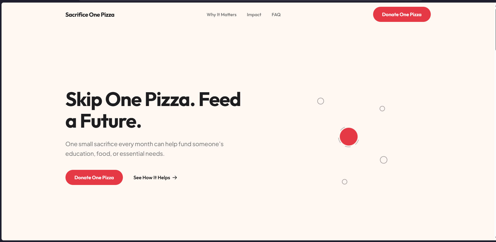
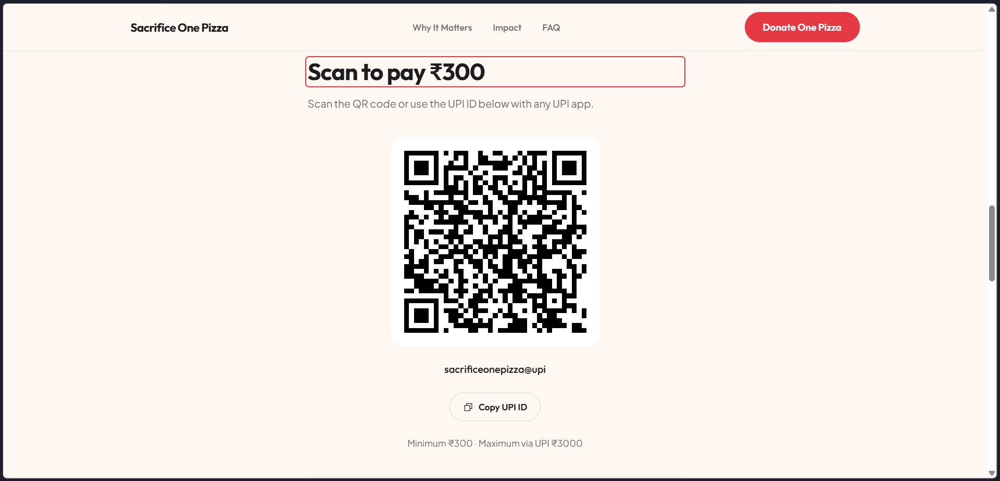
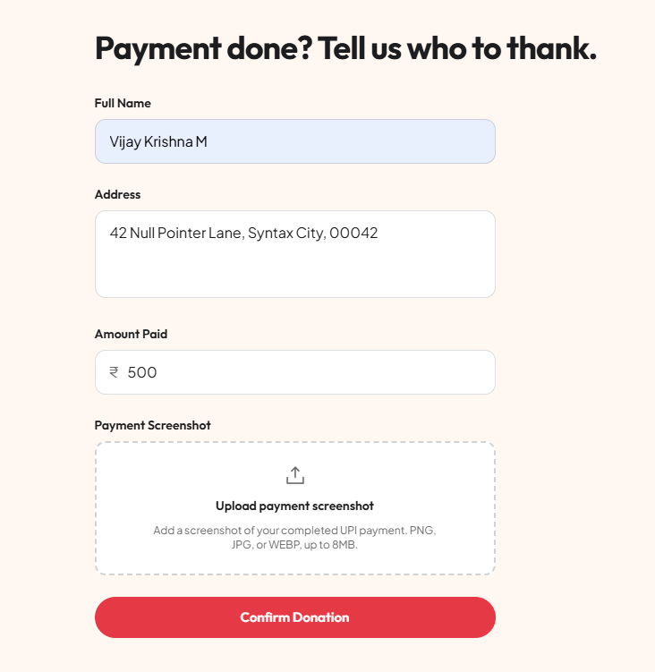

## Problem

Most informal UPI donation pages are a single static QR code with no
confirmation step, or a form that quietly implies the payment has been
verified when nothing on the page could possibly know that. Sacrifice One
Pizza starts from a simple behavioral premise — what you'd spend on one pizza
(₹300–₹3000) can instead fund someone's education or essential needs — and
had to turn that into an honest donation flow: show the donor exactly how to
pay, let them pay in their own UPI app, and collect proof of payment without
ever claiming to verify a transaction the site has no access to.

---

## Background

Built as a portfolio project from a product brief and design spec (target
amounts, UPI-only payment, a warm and editorial tone rather than a
guilt-driven one). There's no payment gateway integration and no backend —
UPI supports peer-to-peer QR/deep-link payments without one, which shaped the
entire flow around "donor pays externally, then confirms" rather than an
in-page checkout. Designed and built solo, end to end.

---

## Constraints

No payment gateway meant no server-side confirmation was possible, and the
UI could never imply otherwise. Donation amounts had to be user-entered
rather than preset buttons, valid only in a ₹300–₹3000 UPI range. The
signature hero effect had to stay SVG/CSS only — no animation library, no
canvas — to keep it lightweight. And accessibility couldn't be a final pass:
it had to hold up to actually testing keyboard and focus behavior, not just
adding ARIA attributes and calling it done.

---

## Research

Before writing the donation flow, I confirmed the UPI deep-link format
(`upi://pay?pa=...&am=...`) so the QR code could be generated correctly
client-side with the donor's exact amount pre-filled, instead of shipping a
static placeholder image. I also initially modeled the testimonial
navigation on the WAI-ARIA tabs pattern before realizing that pattern
requires arrow-key roving focus I hadn't built — a dead end caught during
the accessibility audit and corrected to a plainer, honestly-scoped pattern
(see Challenges).

---

## Architecture

The app is a single Vite/React/TypeScript bundle with no router and no
backend — one page, one flow, walked through below.

```
┌──────────────┐    ┌──────────────┐    ┌──────────────┐    ┌──────────────┐
│    Amount    │───▶│   Payment    │───▶│ Confirmation │───▶│   Success    │
│ (live-valid.)│    │  (QR + UPI)  │    │(form+upload) │    │              │
└──────────────┘    └──────────────┘    └──────────────┘    └──────────────┘
```

The donation experience, the most complex part, is three separate,
purpose-scoped state machines rather than one large reducer or a pile of
booleans: `donationReducer` tracks which of the four screens is showing;
`confirmationFormReducer` owns the form's fields, validation errors, and
submission status; `useScreenshotUpload` owns the upload lifecycle
independently of both. I rejected a single combined reducer early — it
would mean every keystroke in the confirmation form re-evaluates
step-transition logic that has nothing to do with typing, and would give the
outer flow field-level responsibility that three of its four screens never
touch.

---

## Technical Decisions

### Decision: Hero animation implementation

**Options considered:**

- A heavier animation library — convenient orchestration, but a bundle-size
  cost for something native CSS already does well.
- Canvas or a particle system — more visual flexibility, harder to reason
  about for `prefers-reduced-motion` and DOM-based testing.
- SVG + CSS keyframes, no library.

**Chosen:** SVG + CSS keyframes.

**Why:** The animation only needed a handful of elements — five dots, one
core, up to five accumulating "facets" — animating transform/opacity on a
shared clock, exactly what native CSS keyframes do well. A library would
have paid a bundle-size cost for orchestration this simple.

### Decision: What "uploading" means with no backend

**Options considered:**

- Fake a network upload with a spinner implying a server received the file.
- Skip the loading state entirely.
- Model "uploading" as real local processing with a short synthetic delay.

**Chosen:** Local processing model.

**Why:** There's no backend, so nothing is transferred over a network when a
file is selected. The state honestly represents generating a local preview
via `URL.createObjectURL`, with a short synthetic delay so the state is
visible rather than an instant flash — disclosed as synthetic in a code
comment, not left to look like a fake "upload succeeded" claim.

---

## Challenges

**Facet timing bug.** The hero's rim facets initially reused the dots'
negative-`animation-delay` stagger trick — safe for the dots, whose resting
pose looks the same at any phase, but wrong for facets, whose only hidden
window is the first 8% of their cycle. It put four of five facets into an
"already revealed" state on the very first frame. Scrubbing the Web
Animations API's `currentTime` confirmed the timing math but completely
missed this, since that technique never observes the untouched render. Only
watching the actual page load caught it. Fixed by giving every facet its own
keyframe on one shared, un-shifted clock.

**Focus management.** Advancing the donation flow removed the clicked button
from the DOM each time, and browsers silently reset focus to `<body>` — no
signal to keyboard or screen reader users that anything changed. The same
root cause reappeared twice more: a failed submission never focused the
error, and closing the mobile menu via Escape stranded focus. I fixed all
three the same way — explicitly focusing the new step's heading, the first
invalid field, or the menu's toggle button.

**ARIA mismatch.** Testimonial navigation used `role="tab"`/`"tablist"`,
which implies arrow-key roving focus per the WAI-ARIA Authoring Practices —
a behavior I hadn't built. Claiming a widget role without its required
interaction is worse than not claiming it, so I switched to plain buttons
with `aria-current`.

---

## Tradeoffs

I skipped a visible "validating" state in the confirmation form's
submission lifecycle — validation is synchronous, so a dedicated state
would be true for 0ms and rendered for no visible reason. I also kept the
donation service boundary deliberately minimal: no retry logic, no request
cancellation, no generic API client, since none of that has a real backend
to justify it yet. And the hero's rim facets trade DRYness for correctness —
five hardcoded keyframes instead of one shared, delay-staggered keyframe —
because the shared version is exactly what caused the bug above.

---

## Results

This is a portfolio build, not a live fundraising product — there are no
real donors or donation totals to report. What I can state factually: the
app type-checks and lints clean, the production bundle is roughly 83KB of
JS and 15KB of CSS gzipped, and the full donation flow, focus management,
and reduced-motion behavior were verified end-to-end against the actual
deployed production build, not just the local dev server. Every
accessibility fix above was confirmed by inspecting real DOM/focus state
afterward, not assumed from the code.

---

## Lessons Learned

The clearest lesson: a technique that verifies the mechanism — scrubbing
`currentTime`, reading the JSX — can still miss what the browser actually
renders on load. I now treat "watch the real, untouched page" as a mandatory
check, not a nice-to-have, especially around delay-based animation
staggering. The second: three unrelated-looking bugs (donation steps, form
validation, mobile menu) turned out to share one root cause. Naming that
pattern once was more valuable than patching each symptom separately.

---

## Future Improvements

The most consequential next step is a real backend behind
`donationService.submitDonation` — currently a single documented function
boundary — accepting the donor's name, address, amount, and screenshot, and
returning a submission status. That unlocks the rest: secure, non-public
storage for uploaded screenshots, an actual verification/admin review
workflow, and donor notifications once a submission is reviewed. None of
this exists today; the UI is intentionally careful never to imply otherwise.

---

## Gallery

{/* Cover image is automatic from frontmatter. Add supplemental images below. */}


*The signature animation: individual marks travel to a core and merge, each leaving a trace on its rim.*


*Client-generated UPI QR code with the donor's exact amount pre-filled.*


*The confirmation form and its screenshot uploader, mid-validation.*

---

## References

- [WAI-ARIA Authoring Practices — Tabs Pattern](https://www.w3.org/WAI/ARIA/apg/patterns/tabs/) — the spec that surfaced the testimonial navigation's ARIA mismatch during the accessibility audit.
